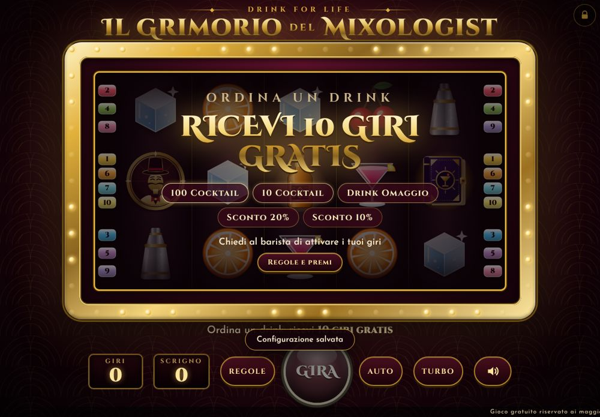
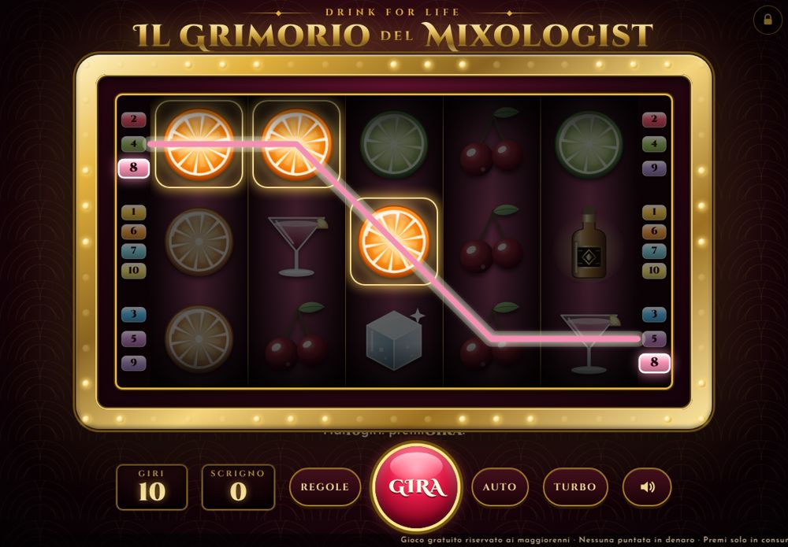
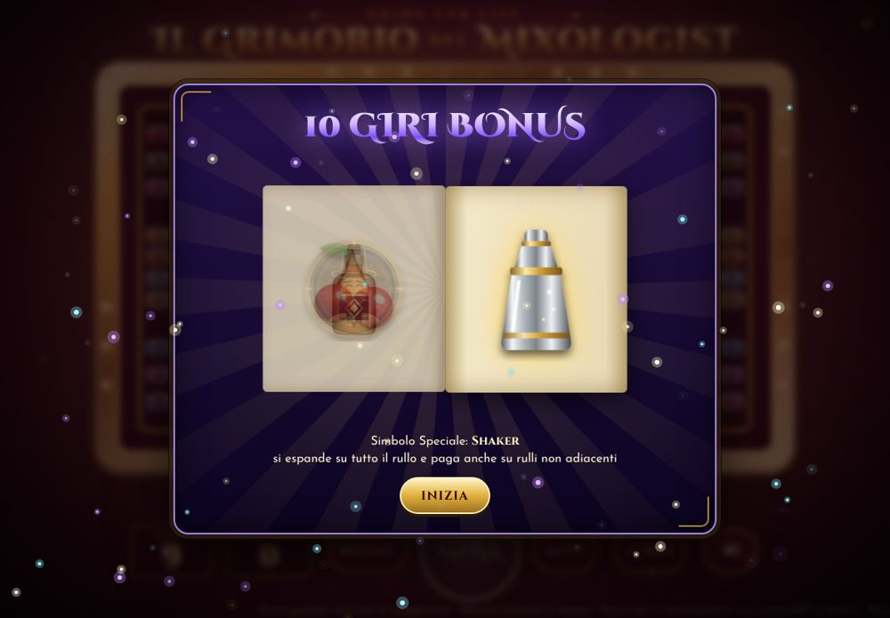
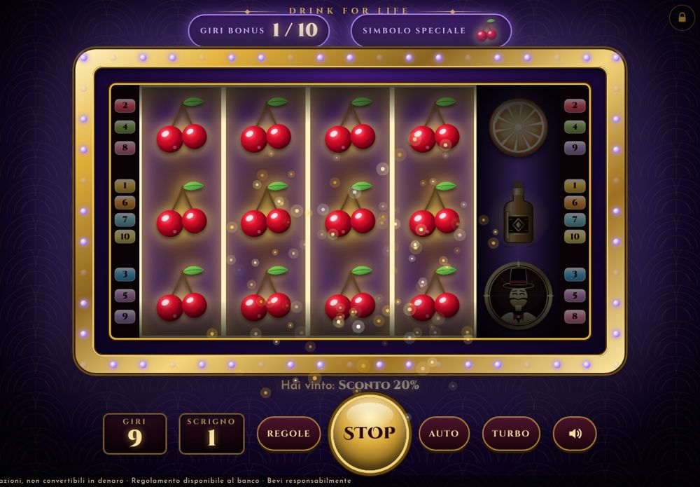
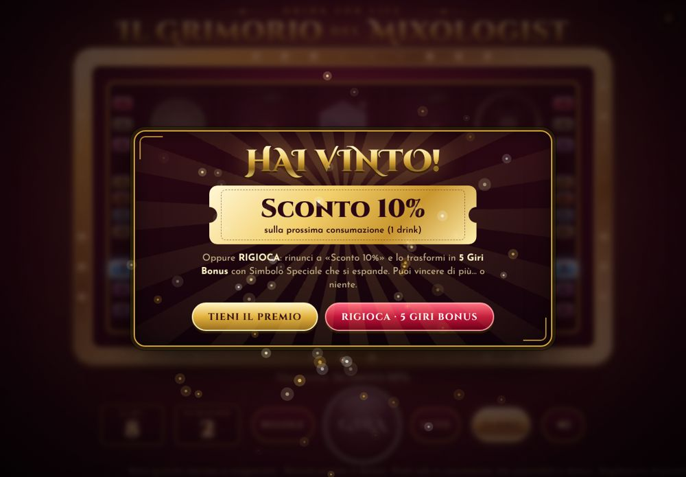
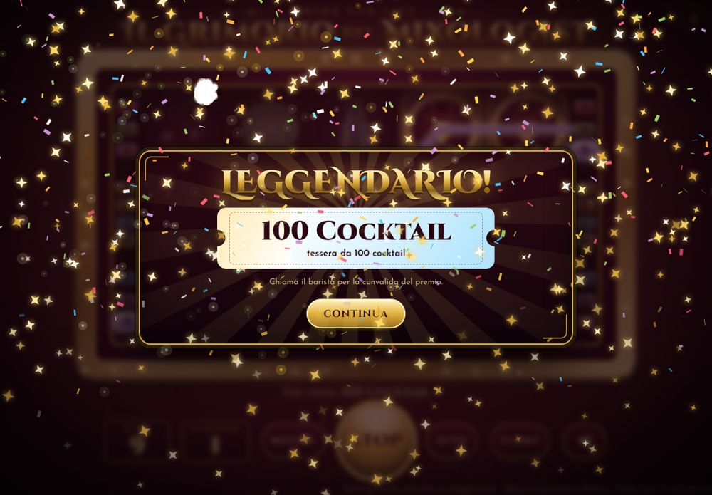
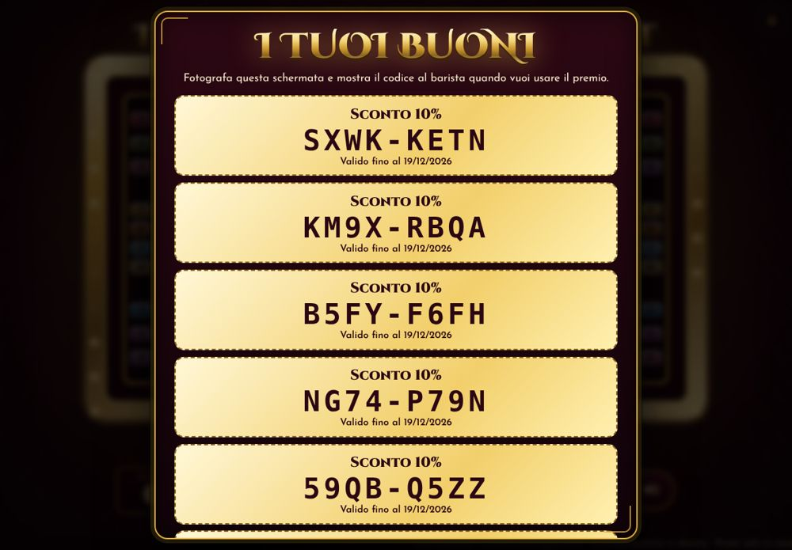

# Il Grimorio del Mixologist

Slot machine a premi in consumazioni per il bar: **ogni drink acquistato dà 10 giri gratis**. Non si accetta denaro e non si punta nulla: si vincono solo sconti, drink e tessere cocktail, oppure altri giri.

Il tema è originale (un grimorio magico da barman). La meccanica è quella del genere "book slot": 5 rulli × 3 righe, 10 linee e un libro jolly/scatter che apre i Giri Bonus con un Simbolo Speciale che si espande.



| Vincita su linea | Giri Bonus | Simbolo Speciale espanso |
|---|---|---|
|  |  |  |

| Rigioca il premio | Jackpot | Buoni |
|---|---|---|
|  |  |  |

---

## 1. Come funziona

### Per il cliente
1. Ordina un drink. Il barista attiva i giri sul tablet con il suo PIN (1 drink = 10 giri).
2. Preme **GIRA**, oppure **AUTO**. **TURBO** rende i rulli più veloci.
3. Esiti possibili a ogni giro:
   - **niente**;
   - **giri extra** (+1/+2/+3, con 3–5 frutti o ghiaccio in linea);
   - **premio**: Sconto 10%, Sconto 20%, Drink Omaggio, 10 Cocktail, 100 Cocktail;
   - **Giri Bonus**: con 3 o più Grimori il libro si apre, sceglie un Simbolo Speciale e regala 10 giri in cui quel simbolo si espande su tutto il rullo.
4. **Rigioca**: uno sconto o un drink omaggio si può trasformare subito, o a fine partita, in Giri Bonus. Si può vincere di più o perdere il premio.
5. A fine giri lo **Scrigno** riepiloga i premi. Con **RITIRA** si ottengono buoni con codice (es. `HESP-8QBV`) e scadenza, da fotografare e mostrare al banco.

### Per il barista (lucchetto in alto a destra → PIN barista)
- **Attiva giri**: scegli il numero di drink e premi ATTIVA.
- **Riscatta un buono**: digita il codice, poi VERIFICA e SEGNA COME USATO. Le tessere da 10/100 cocktail si scalano un po' alla volta, entro il limite giornaliero.
- **Chiudi sessione**: se un cliente se ne va a metà, i premi in sospeso diventano buoni.

### Per il gestore (PIN gestore)
Statistiche (giorno/mese/anno), registro buoni (ricerca e annullo), tabella probabilità, impostazioni, backup/ripristino, cambio PIN, **modalità demo** (premi non validi e non conteggiati).

---

## 2. Perché non ti manda in bancarotta

| Protezione | Come funziona |
|---|---|
| **Costo atteso fisso** | Profilo "Bilanciato": in media i premi valgono il **4,89%** del prezzo di ogni drink venduto (es. drink a 10 € → 0,49 € a listino, circa 0,12 € di costo merce). Il valore è calcolato in forma esatta e verificato con simulazioni. |
| **Premi alti rarissimi** | 10 Cocktail: in media 1 ogni ~4.500 drink. 100 Cocktail: 1 ogni ~280.000 drink. |
| **Tetti rigidi** | Limiti per giorno, mese e anno su ogni premio. Predefiniti: 100 Cocktail max **1 l'anno**, 10 Cocktail max **2 al mese** e 12 l'anno, Drink Omaggio max 8 al giorno e 150 al mese. Se un premio è esaurito, il giro assegna il premio inferiore (mai uno superiore). |
| **Tessere a rate** | Le tessere da 10/100 cocktail si usano al massimo 2 al giorno (configurabile). La tessera da 100 dura 2 anni. |
| **Rigioca svantaggioso** | Convertire un premio restituisce in media il 67–74% del suo valore: più i clienti rigiocano, meno spendi. Simulazione con il 100% di rigiocate: costo 2,8%. Massimo 3 rigiocate per drink. |
| **Sessioni limitate** | Massimo 15 giri extra e 40 giri bonus per drink. |
| **Nessun trucco possibile** | Estrazione con generatore crittografico (Web Crypto). Il risultato è deciso e salvato **prima** dell'animazione: ricaricare la pagina non ripete il giro. I PIN sono protetti da hash e l'accesso si blocca dopo 5 tentativi errati. |

### Tabella dei profili (impostazioni → Profilo di generosità)

| Premio | Prudente | Bilanciato | Generoso |
|---|---|---|---|
| Sconto 10% | 1 ogni 8,6 drink | 1 ogni 5,1 drink | 1 ogni 3,1 drink |
| Sconto 20% | 1 ogni 25,5 drink | 1 ogni 15,1 drink | 1 ogni 9,0 drink |
| Drink Omaggio | 1 ogni 125 drink | 1 ogni 74,0 drink | 1 ogni 44,3 drink |
| 10 Cocktail | 1 ogni 4.456 drink | 1 ogni 4.456 drink | 1 ogni 4.456 drink |
| 100 Cocktail | 1 ogni 282.553 drink | 1 ogni 282.553 drink | 1 ogni 282.553 drink |
| Giri Bonus | 1 ogni 9,2 drink | 1 ogni 9,2 drink | 1 ogni 9,2 drink |
| **Valore medio premi / prezzo drink** | **3,00%** | **4,89%** | **8,00%** |
| Rigioca (Sconto 10% / 20% / Drink) | 9 / 15 / 90 giri | 5 / 10 / 55 giri | 3 / 6 / 30 giri |

Sono medie di lungo periodo, prima dell'effetto dei tetti, che possono solo ridurle. Il valore è al prezzo di listino, quindi prudenziale: non considera i buoni che scadono senza essere usati.

---

## 3. Installazione sul tablet

L'app è un'unica pagina web (`docs/index.html`): grafica, font e suoni sono inclusi e non servono server né database. I dati restano sul tablet.

### Opzione A: GitHub Pages (consigliata)
1. Su GitHub: **Settings → Pages → Build and deployment → Deploy from a branch**, scegli il branch e la cartella **`/docs`**.
2. Apri sul tablet l'indirizzo `https://<utente>.github.io/<repository>/`.
3. Aggiungilo alla schermata Home (Safari: Condividi → *Aggiungi a Home*; Chrome: *Installa app*). Si apre a schermo intero e, dopo il primo caricamento, **funziona anche offline**.

> GitHub Pages su repository privati richiede un piano GitHub a pagamento. In alternativa va bene qualsiasi hosting statico HTTPS (Netlify, Cloudflare Pages, il sito del bar).

### Opzione B: file locale
Copia `docs/index.html` sul tablet e aprilo nel browser. Funziona, ma senza installazione a schermo intero e senza cache offline.

### Modalità chiosco (per impedire ai clienti di uscire dall'app)
- **iPad**: Impostazioni → Accessibilità → **Accesso Guidato**; nell'app, triplo clic sul tasto laterale.
- **Android**: Impostazioni → Sicurezza → **Blocco app** (App pinning).
- Disattiva lo spegnimento automatico dello schermo e tieni il tablet in carica.

### Primo avvio
Una procedura guidata chiede il nome del locale, il prezzo medio di un drink, il **PIN barista** (4–6 cifre) e il **PIN gestore** (6–8 cifre).

---

## 4. Manutenzione

- **Backup mensile**: Gestione → Backup → *Backup completo (JSON)*. Il registro dei buoni esiste solo sul tablet: se il tablet si guasta o il browser viene azzerato, senza backup i buoni emessi non sono più verificabili e i tetti ripartono da zero.
- Il registro conserva i buoni validi e quelli chiusi negli ultimi 60 giorni. Le statistiche restano per sempre.
- Usa **un solo tablet** per il gioco: tetti e registro sono per dispositivo.
- Non usare la navigazione privata: i dati andrebbero persi alla chiusura.

---

## 5. Sviluppo

```
src/            sorgenti (moduli ES): motore, grafica, pannelli
  js/rng.js        generatore crittografico, estrazioni senza distorsioni
  js/paytable.js   simboli, linee, tabella vincite (unica fonte di verità)
  js/math.js       calcolo esatto del costo atteso e delle frequenze
  js/presets.js    profili Prudente / Bilanciato / Generoso
  js/engine.js     estrazione dell'esito e costruzione della griglia coerente
  js/game.js       logica di sessione (giri, bonus, premi, rigioca)
  js/store.js      registro buoni, tetti, PIN, statistiche, backup
  js/app.js, reels.js, fx.js, audio.js, symbols.js, admin.js, ui.js   interfaccia
docs/           build pubblicabile (generata)
tests/          test automatici
tools/          build, simulazione, report
```

```bash
npm test                                   # 25 test: valutazione, generatore, frequenze, tetti, buoni, PIN
npm run build                              # rigenera docs/ (index.html autosufficiente, service worker, icone)
node tools/simulate.mjs 200000 bilanciato 0.5   # Monte Carlo: 200.000 drink, 50% di premi rigiocati
node tools/report.mjs                      # tabella dei profili
```

**Come si decide un giro.** Prima si estrae l'esito dalla tabella delle probabilità; poi si applicano i tetti; infine si costruisce una griglia 5×3 che, valutata con le regole pubbliche, produce **esattamente** quell'esito e nient'altro. I test generano decine di migliaia di griglie per ogni esito e verificano la coerenza.

Font: Cinzel, Cinzel Decorative, Josefin Sans (SIL Open Font License, vedi `src/fonts/`). Simboli, grafica e suoni sono originali (SVG e Web Audio).

---

## 6. Note legali

Prima di usarlo con clienti reali leggi **[LEGALE.md](LEGALE.md)**: il gioco va inquadrato come concorso a premi (DPR 430/2001), ci sono profili TULPS e fiscali da verificare e potrebbe servire una cauzione.
